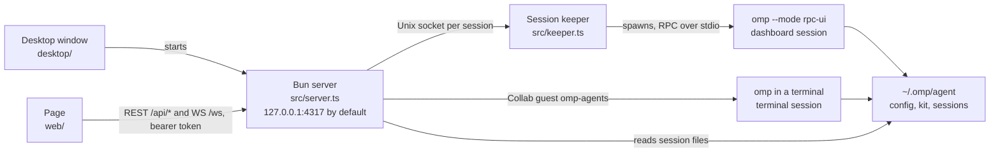
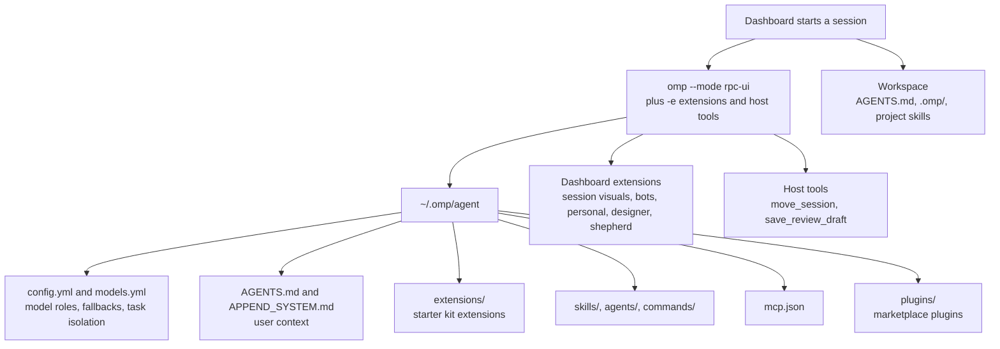
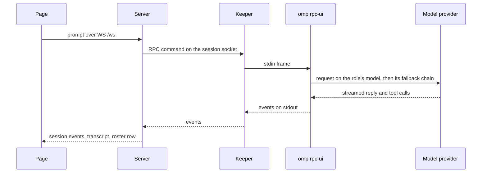
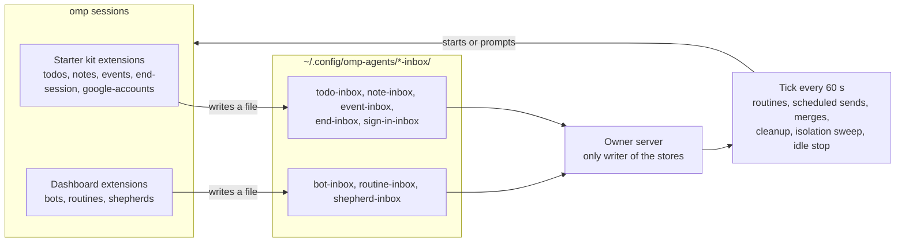
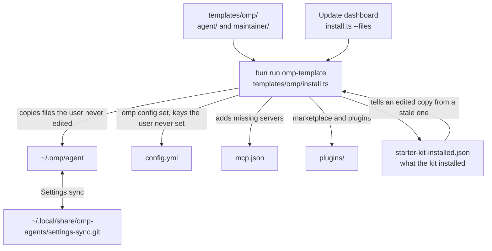

# Harness map

Five diagrams of how the dashboard, omp, and the starter kit fit together on one computer.
Each subsystem's own file in this directory holds the details; this page is where to start before you open one.

## Processes

The desktop window starts the server, the page talks to the server, and the server reaches every omp session either through a keeper or as a Collab guest.

[Desktop shell](desktop-shell.md) covers the window, [Session keepers](dashboard-sessions.md#session-keepers) the keepers, and [Terminal sessions](terminal-sessions.md) the Collab join.

## What a dashboard session loads

omp loads the user's config and the starter kit from `~/.omp/agent`, the project's own files from the workspace, and the extras the dashboard passes when it starts the session.

[Dashboard sessions](dashboard-sessions.md) says which extensions and host tools each kind of session gets.

## A message from the page to the model

A prompt typed on the page travels over the socket to the server, through the keeper to omp, and the events come back the same way.

[Socket requests](socket-requests.md) lists the messages, and the model-routing doc in the starter kit says how roles and fallbacks pick a model.

## Unattended work and file inboxes

Only the server that holds the owner lock runs the unattended work, and sessions hand facts to it by writing files into inbox directories it alone reads and applies.

[One server runs the unattended work](routines.md#one-server-runs-the-unattended-work) covers the owner lock, [Isolation sandboxes](routines.md#isolation-sandboxes) the sweep, and [The idle stop](session-processes.md#the-idle-stop) the stop.

## How the starter kit reaches ~/.omp/agent

The repository's `templates/omp/` is the starter kit, and the installer copies it into `~/.omp/agent` while it keeps the files and settings the user changed.

[Starter kit and docs](../code-layout/starter-kit-and-docs.md) covers the installer, [Updating the dashboard](updating-the-dashboard.md) the update, and [Settings sync](settings-sync.md) the sync repository.
A file the kit stops shipping stays in `~/.omp/agent` until the user deletes it, since the installer only adds and updates files.
